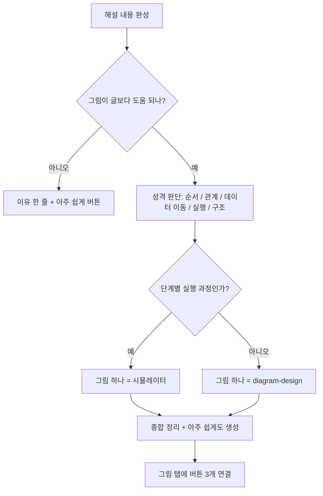
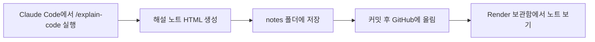

# PRD: 코드 해설 노트 (가칭)

> 코드나 배운 내용(텍스트)을 넣으면 Claude Code가 초보자용 해설 노트(쉬운 주석·풀어쓰기·단어장·시각화)를 만들고, 그 노트를 웹사이트에서 모아 보는 개인 공부 도구

---

## 0. 용어

- PRD(피알디) = 무엇을·왜 만들지 정리한 기획서
- 스킬(skill) = Claude Code에 추가하면 Claude가 정해진 방식으로 일하게 하는 지시문과 도구 묶음
- 슬래시 명령(slash command) = Claude Code 입력창에 `/이름`을 쳐서 스킬을 부르는 방법
- CLAUDE.md(클로드 엠디) = 프로젝트 폴더에 두면 Claude Code가 작업 시작 때마다 자동으로 읽는 규칙 파일
- Render(렌더) = 올린 파일이나 프로그램을 인터넷 주소로 공개해 주는 배포 서비스. 정적 사이트는 무료로 쓸 수 있다. 배포는 GitHub Pages 대신 Render로 한다 (지시)
- 정적 사이트(static site) = 서버 프로그램 없이 HTML·CSS·JavaScript 파일만으로 보이는 웹사이트
- 시뮬레이터(simulator) = 코드가 한 줄씩 실행되는 과정을 클릭하며 한 단계씩 보여 주는 화면

---

## 1. 서비스 개요

**만드는 것은 두 부분이다.**

| 부분 | 하는 일 | 실행 위치 |
|---|---|---|
| 해설 생성 | 코드 또는 배운 내용(텍스트)을 받아 해설 노트(HTML 파일)를 만든다 | Claude Code (내 컴퓨터) |
| 노트 보관함 | 만들어진 노트를 목록으로 모아 브라우저에서 보여 준다 | 웹사이트 (Render 정적 사이트) |

이렇게 나눈 이유:
- 생성을 Claude Code가 하므로 **API 키가 필요 없고**, 키 노출 위험과 API 비용이 없다.
- 결과는 HTML 파일이므로 웹사이트에 올리면 **제출 기준(브라우저에서 동작)** 을 맞출 수 있다.

---

## 2. 도메인 연결 문장

> 코딩 입문 학습이라는 내 분야에서, **AI가 만들어 준 코드나 수업에서 배운 글을 받아도 무슨 뜻인지 몰라 매번 "쉽게 다시 설명해 줘"를 반복해야 하는 불편**을 해결한다.

---

## 3. 타겟 사용자

- 나 자신: 바이브코딩으로 코딩을 처음 배우는 입문자, 영어 명령어가 낯선 사람
- 개인 공부용, 상업적 이용 없음

---

## 4. 해결할 문제

| 지금의 불편 | 해결 방법 |
|---|---|
| 주석이 어려운 전문용어로 적혀 있다 | 쉬운 단어로 바꾼 주석 |
| 배운 내용이 전문용어 글로만 되어 있어 이해가 안 된다 | 문단마다 쉬운 말로 풀어쓴 텍스트 노트 |
| 전체 흐름과 세부 동작을 한 번에 보기 어렵다 | 흐름 버전 / 자세히 버전 분리 |
| 영어 단어 뜻·발음을 따로 찾아야 한다 | 한글 발음·뜻 단어장 자동 정리 |
| 글로만 된 설명은 구조가 안 보인다 | 개념에 맞는 그림 자동 선택, 버튼으로 세 가지 버전 비교 |
| 해설이 채팅창에 흩어져 다시 찾기 어렵다 | 노트 보관함 웹사이트에 모아 둠 |

---

## 5. 설명 규칙 (1단계부터 적용, CLAUDE.md에 넣는다)

1. 새 용어는 맨 앞에 `용어 = 한 줄 정의` 형식으로 먼저 보여 준다. 새 용어에는 한글 개념어만 넣고, 영어 단어·약어·명령어·도구 이름은 6번 단어장에 넣는다. 같은 낱말을 양쪽에 중복해서 쓰지 않는다.
2. 결론 먼저, 내용은 겹치지 않게 나눈다 (맥킨지 식).
3. 원리를 쉬운 말로 먼저, 용어 이름은 나중에 (파인만 식).
4. **비유는 최소.** 실제로 일어나는 일(코드·동작 과정)로 설명한다. 한 줄 정의 안에도 비유를 넣지 않는다. 사용자가 "도저히 이해 못 하겠다"고 할 때만 비유를 쓴다. `/eli5`를 부를 때도 이 규칙을 함께 지시한다.
5. 주석은 두 버전으로 쓴다.
   - 흐름 버전: 한 줄에 짧게, 이 줄이 전체에서 하는 역할
   - 자세히 버전: 명령어가 실제로 어떻게 작동하는지 (예: `from` 여기서 `import` 이 도구를 가져온다). 설치 방법은 뺀다.
   - 텍스트 노트는 주석 대신 요약(결론 먼저 핵심 3~5줄)과 풀어쓰기(문단마다 쉬운 말로 다시 설명)로 쓴다.
6. 영어 단어는 `단어(한글 발음): 뜻` 형식으로 노트 맨 아래에 모은다.
7. 확실한 것과 추측을 구분해 표시한다. 모르면 모른다고 쓴다.
8. 애매한 것은 스스로 판단하지 말고 사용자에게 묻는다.

---

## 6. 기능 범위

### 1단계: MVP

**① 입력** — 내가 만드는 스킬 `/explain-code`, 종류를 직접 고른다 (자동 판단 안 함)
- 코드: `/explain-code 코드 game.js` (파일 경로) 또는 `/explain-code 코드` 후 채팅에 코드 붙여 넣기
- 텍스트: `/explain-code 텍스트 notes.txt` (파일 경로) 또는 `/explain-code 텍스트` 후 채팅에 글 붙여 넣기
- 종류를 빼먹으면 스킬이 어느 쪽인지 묻는다

**② 해설 노트** — `notes/<날짜-주제>/index.html` 한 장, 탭 구성
- 코드 노트: 흐름 버전 주석 / 자세히 버전 주석 / 영어 단어장 (단어, 한글 발음, 뜻)
- 텍스트 노트: 요약 / 풀어쓰기 / 영어 단어장
- 그림 (아래 ③, 두 종류 모두)

**③ 그림 탭** — AI가 먼저 그림 필요 여부와 종류를 판단 (7장)

그림이 필요할 때, 버튼 3개로 바꿔 본다:

| 버튼 | 보여 주는 것 | 만드는 도구 |
|---|---|---|
| [종합 정리] | 그림·표 여러 개를 한 장에 모은 정리 페이지 | answer-me-with-html |
| [그림 하나] | 7장에서 고른 종류의 핵심 그림 하나 | /diagram-design (단, "단계별 실행 과정"이면 직접 만든 시뮬레이터) |
| [아주 쉽게] | 큰 그림, 적은 글로 된 쉬운 설명 | /eli5 |

그림이 필요 없을 때:
- "그림이 필요 없는 이유" 한 줄 표시
- [아주 쉽게] 버튼만 남김 ([종합 정리], [그림 하나]는 표시 안 함)

**④ 시뮬레이터** — 단계별 실행 과정용, 직접 제작
- 위: 현재 단계 번호와 해설 (크게)
- 아래: 코드, 지금 실행 중인 줄 강조
- [이전] [다음] 버튼으로 한 단계씩 이동

**⑤ 노트 보관함** — 루트 `index.html`, `notes/` 안의 노트 목록을 날짜순으로 보여 줌

**⑥ 공개** — Render 정적 사이트 (GitHub Pages는 쓰지 않는다)

### 2단계: 나중에 추가

- `/feynman-technique` 모드: 원리 → 이름 → 쉬운 단계부터 어려운 단계로 설명 (비유 부분은 5장 규칙 4에 따라 빼도록 지시)
- 보관함 검색
- 모든 노트의 단어장을 한곳에 모아 보기

### 하지 않을 것

- 로그인, 회원 기능, 결제
- 웹사이트에서 직접 AI 호출 (API 키가 필요해지므로)
- 여러 사람이 함께 쓰는 기능

---

## 7. AI 시각화: 개념에 맞는 그림 고르기

**핵심: 무조건 그림을 만드는 것이 아니라, 설명 내용의 성격을 먼저 판단하고 맞는 그림을 고른다.** 고른 이유를 노트에 한 줄로 적는다.

| 설명 내용의 성격 | 고를 시각화 | [그림 하나] 버튼의 도구 |
|---|---|---|
| 순서대로 진행, 조건에 따라 갈라짐 | 플로우차트 | /diagram-design Flowchart |
| 개념끼리 포함·연결 관계 | 개념 관계도 | /diagram-design Tree·Nested |
| 데이터가 어디서 어디로 이동 | 데이터 이동 구조도 | /diagram-design Sequence·Data flow |
| 한 줄씩 실행되며 값이 바뀜 | 단계별 실행 과정 | 직접 만든 시뮬레이터 |
| 파일·함수가 어떻게 나뉘었는지 | 코드 구조도 | /diagram-design Tree·Architecture |
| 한두 줄짜리 단순 개념 | **그림 안 만듦** | 이유 한 줄 + [아주 쉽게]만 |



---

## 8. 사용 흐름



---

## 9. 폴더 구조

```
code-explain-notes/
├─ CLAUDE.md              # 5장 설명 규칙
├─ PRD.md                 # 이 문서
├─ retrospective.md       # 회고록
├─ index.html             # 노트 보관함 (목록)
├─ templates/
│  └─ simulator.html      # 시뮬레이터 틀
├─ notes/
│  └─ 2026-11-03-for문/
│     ├─ index.html       # 흐름 / 자세히 / 단어장 / 그림 탭
│     ├─ summary.html     # [종합 정리] answer-me-with-html
│     ├─ diagram.html     # [그림 하나] diagram-design 또는 시뮬레이터
│     └─ eli5.html        # [아주 쉽게] eli5
└─ .claude/
   └─ skills/
      └─ explain-code/
         └─ SKILL.md      # 내가 만드는 스킬
```

---

## 10. Claude Code 작업 순서

MVP가 크므로, 중간에 멈춰도 "어디까지 굴러가나"를 보여 줄 수 있게 작은 단위로 나눠 커밋한다.

1. **스킬 확인**: Claude Code에서 `/`를 쳐서 `eli5`, `diagram-design`, `feynman-technique`, `answer-me-with-html`이 보이는지 확인. 없는 것은 설치 방법을 찾는다.
2. 저장소 만들기, CLAUDE.md에 5장 규칙 넣기 → 커밋
3. `/explain-code`: 주석 2버전 + 단어장 노트 → 짧은 코드로 시험 → 커밋
4. 노트 보관함 `index.html` + Render 공개 → 커밋 **(여기까지 오면 최소 제출 가능)**
5. 그림 필요 여부·종류 판단 + 이유 한 줄 → 커밋
6. 버튼 3개 연결: [종합 정리] [그림 하나] [아주 쉽게] → 커밋
7. 시뮬레이터 틀 만들고 "단계별 실행 과정"에 연결 → 커밋
8. 입력 방식 두 가지(파일 경로, 붙여 넣기) 모두 시험 → 커밋

> AI와 주고받은 대화는 지우지 않는다 (평가 항목: AI 활용도).

---

## 11. 성공 기준

- 처음 보는 사람이 Render 주소에 들어가서 노트 하나를 열고, 흐름·자세히·단어장 탭을 볼 수 있다.
- 그림이 필요한 노트에서는 버튼 3개로 세 가지 버전을 바꿔 볼 수 있다.
- 한 줄씩 실행되는 코드의 노트에서는 [그림 하나]에서 시뮬레이터를 클릭하며 볼 수 있다.
- 단순한 코드의 노트에는 그림 대신 이유 한 줄과 [아주 쉽게] 버튼만 나온다.

---

## 12. 평가 루브릭 연결

| 항목 | 비중 | 이 프로젝트의 증거 |
|---|---|---|
| 도메인 연결성 | 25% | 2장 문장 |
| 기능 완성도 | 25% | 10장 작업 순서 중 도달한 번호 |
| AI 활용도 | 20% | Claude Code 대화 기록, 직접 만든 스킬 |
| 회고 깊이 | 15% | retrospective.md: 내린 결정과 미룬 기능, 그 이유 |
| 발표/시연 | 15% | 30초 요약: "AI 코드를 받으면 쉬운 주석·단어장·그림으로 바꿔 모아 본다" |

---

## 13. 위험 요소와 확인할 것

| 내용 | 구분 |
|---|---|
| 노트 보관함은 정적 사이트라 Render 정적 사이트로 공개할 수 있다 (Render 정적 사이트로 배포해 확인함) | 확실 |
| 그림 버전 3개를 모두 만들므로 노트 하나 만드는 시간이 길어진다 | 확실 |
| MVP 범위가 커서 하루 안에 10장 8번까지 끝내기는 어려울 수 있다 | 추측 |
| 웹사이트에서는 새 해설을 만들 수 없고 만들기는 Claude Code에서만 된다. "실행 가능한 웹 서비스"로 인정받을 수 있는지 강사에게 확인 필요 | 확인 필요 |
| `/eli5`는 "큰 그림, 적은 글" 방식이라 비유가 섞일 수 있다 → 5장 규칙 4를 함께 지시 | 확실 |
| `/feynman-technique`는 비유 하나를 쓰는 방식을 포함한다 → 비유 부분은 빼도록 지시 | 확실 |
| `/diagram-design`은 프로젝트에서 처음 쓸 때 스타일을 정할지 물어본다 | 확실 |
| 내 Claude Code에 `/eli5`, `/diagram-design`, `/feynman-technique`가 설치되어 있는지는 모름 | 확인 필요 |

### 아직 정하지 않은 것

- [종합 정리]가 7장에서 고른 그림 종류를 따를지, answer-me-with-html이 스스로 구성하게 둘지
- 시뮬레이터를 만드는 방식: 틀(templates/simulator.html)을 한 번 만들어 두고 AI는 단계별 내용만 채우게 할지, 매번 AI가 통째로 만들게 할지

---

## 영어 단어 발음·뜻

- PRD(피알디): 무엇을·왜 만들지 정리한 기획서
- MVP(엠브이피): 핵심 결과 하나를 끝까지 얻는 최소 작동 버전
- skill(스킬): Claude에게 일하는 방식을 알려 주는 추가 기능
- slash command(슬래시 커맨드): `/`로 시작하는 명령
- Render(렌더): 올린 파일을 웹 주소로 공개해 주는 배포 서비스
- static site(스태틱 사이트): 서버 없이 파일만으로 보이는 웹사이트
- template(템플릿): 미리 만들어 둔 틀
- commit(커밋): 지금 상태에 이름을 붙여 복구 지점을 만드는 기록
- flowchart(플로우차트): 흐름도
- sequence(시퀀스): 시간 순서대로 주고받는 흐름
- tree(트리): 위에서 아래로 갈라지는 구조
- nested(네스티드): 안에 안이 들어 있는 구조
- architecture(아키텍처): 부품과 연결을 한 장에 보여 주는 구조
- data flow(데이터 플로우): 데이터가 이동하는 흐름
- simulator(시뮬레이터): 실행 과정을 단계별로 재현하는 화면
- ELI5(이엘아이파이브): Explain Like I'm 5, 다섯 살에게 하듯 쉽게 설명하기
- Feynman technique(파인만 테크닉): 원리를 쉬운 말로 먼저 설명하는 학습법
- retrospective(레트로스펙티브): 회고
