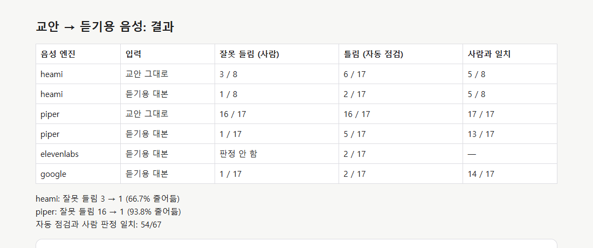
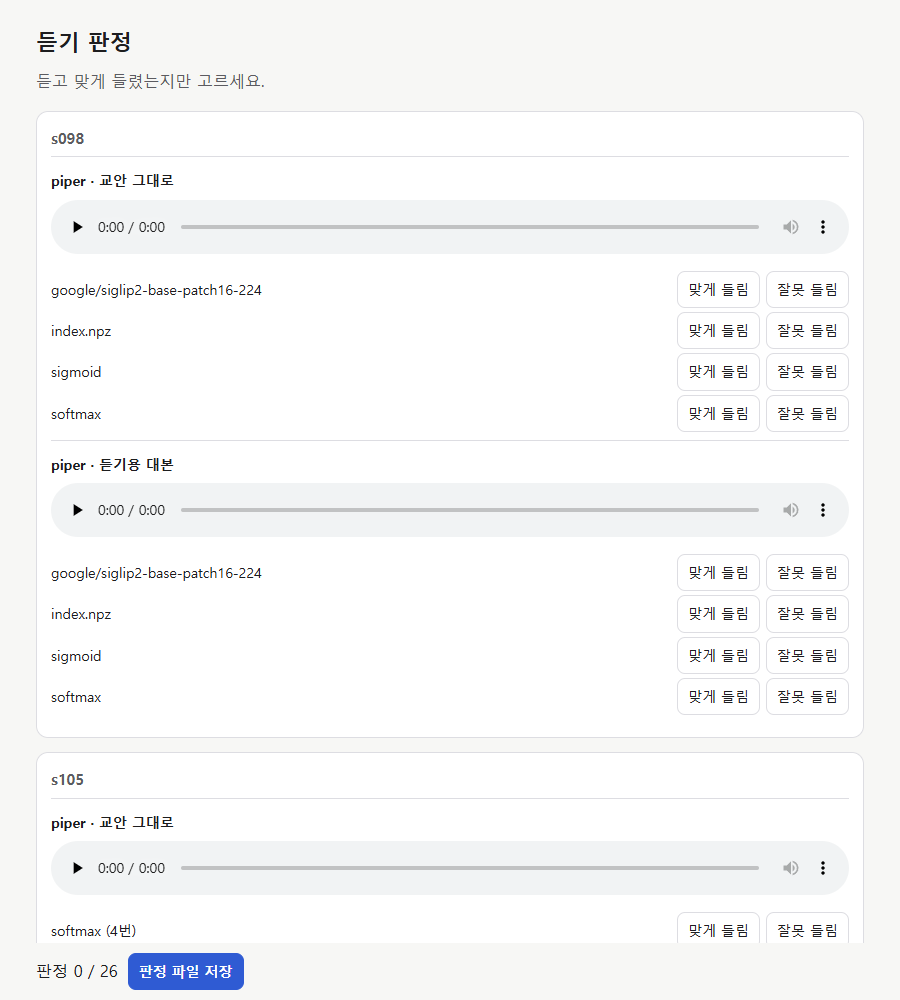

# 교안 → 듣기용 음성 (Main Quest 2 PoC)

수업 교안을 음성으로 듣거나, 이동 중에 **귀로 복습**하려고 만든 PoC입니다.
교안을 그대로 음성 엔진에 넣으면 영어 모델 이름·소수점·기호가 엉뚱하게 읽힙니다.
그래서 AI가 먼저 **듣기용 대본**(영어·숫자를 소리 나는 대로, 표·그림은 빼기)으로 바꾼 뒤 음성으로 만들고,
음성 인식으로 다시 받아 적어 **잘못 읽힌 곳을 자동으로 찾는** 흐름을 만들었습니다.

| 문서 | 내용 |
|---|---|
| [problem.md](problem.md) | 문제 정의서: 도메인, 지금 문제, 개선 가설, 대상 사용자, 성공 기준, **모델 선정 이유** |
| [results.md](results.md) | 개선 효과 검증: 기존 방식과 비교, 성공 기준 판정, **실패 사례** |
| [rules.md](rules.md) | 듣기용 대본 변환 규칙 |
| [answer_key.json](answer_key.json) | 시험 구간과 "이렇게 들리면 맞음" 정답 (모델 돌리기 전에 확정) |

## 왜 만들었나
-  소리로 들으면 집중에도 도움이 될 것으로 기대. 1월부터 기차로 통학할 예정이라, 오가는 길에 교안을 눈으로 보는 것보다 **듣는 쪽이 더 편하다**.
- 교안을 그대로 음성으로 읽히니 **소수점과 특수기호가 섞인 곳에서 오류가 압도적으로** 많았다(Piper 17곳 중 16곳).
- 듣기용 대본을 만들어 다시 읽히니 **오류가 눈에 띄게 줄었다**(17곳 중 1곳).
- Windows 기본 목소리는 듣기 힘든 편이라, 무료 한도가 넉넉한 **Google Cloud TTS**를 대안으로 붙였다.

## 흐름

```
교안 .ipynb
  → extract.py          구간으로 나누기 (문단·표·코드·그림)
  → [AI] 대본 변환       rules.md 대로 듣기용 대본 (Claude Code, 결과는 work/listen_script_test.json 에 저장)
  → tts.py              음성 만들기: Heami(Windows 내장) / Piper(오픈 모델) / Google Cloud TTS / ElevenLabs(API)
  → check.py            음성 인식(faster-whisper)으로 받아 적고 정답과 비교
  → make_judge.py       사람이 듣고 판정하는 화면
  → report.py           results.html / results.csv
```

## 결과 한눈에



- **Piper(무료 오픈 모델)**: 교안 그대로는 어려운 곳 17곳 중 16곳이 잘못 들렸고, 듣기용 대본은 1곳만 잘못 들렸습니다(**93.8% 줄어듦**).
- **Heami(Windows 내장)**: 8곳 중 3곳 → 1곳 (66.7% 줄어듦). 원래 영어를 꽤 잘 읽어서 줄어든 폭이 작았습니다.
- **Google Neural2-C**: 듣기용 대본만 만들었고 17곳 중 1곳만 잘못 들렸습니다. 소수점 숫자의 발음은 아쉬웠다는 후기가 있습니다.
- **자동 점검**은 사람 판정과 67곳 중 54곳(80.6%) 같았습니다. 목표(90%)에는 못 미쳤습니다. 이유는 [results.md](results.md#3-실패-사례)에 있습니다.

들어 보기 (s096 구간: CLIP, SigLIP 2, Apache 2.0이 나오는 문단)
| 음성 엔진 | 교안 그대로 | 듣기용 대본 |
|---|---|---|
| Piper | [s096-piper-plain.mp3](docs/s096-piper-plain.mp3) | [s096-piper-listen.mp3](docs/s096-piper-listen.mp3) |
| Heami | [s096-heami-plain.mp3](docs/s096-heami-plain.mp3) | [s096-heami-listen.mp3](docs/s096-heami-listen.mp3) |
| Google Neural2-C | — | [s096-google-listen.mp3](docs/s096-google-listen.mp3) |
| ElevenLabs | — | [s096-elevenlabs-listen.mp3](docs/s096-elevenlabs-listen.mp3) |

사람 판정 화면 (`make_judge.py`)



## 실행 방법 (Windows)

준비: Python 3.11, [uv](https://docs.astral.sh/uv/), ffmpeg(ElevenLabs mp3 를 쓸 때만).

```powershell
cd 10-lecture-to-audio
uv venv --python 3.11 .venv
uv pip install --python .venv\Scripts\python.exe -r requirements.txt
.venv\Scripts\python.exe -m piper.download_voices --download-dir voices ko_KR-kss-medium
```

같은 결과 다시 만들기 (저장된 대본 `work/listen_script_test.json` 기준)

```powershell
# 1. (선택) 교안 전체를 구간으로 나누기. 교안 파일이 있을 때만. 시험 6구간은 work\segments_test6.json 에 들어 있어 이 단계 없이 돌릴 수 있음
#    .venv\Scripts\python.exe extract.py "내 업무 어디에 AI를 넣을까_.ipynb" work\segments.json

# 2. 음성 만들기 (6구간: work\ids_test6.json)
.venv\Scripts\python.exe tts.py --engine piper --text plain  --ids work\ids_test6.json
.venv\Scripts\python.exe tts.py --engine piper --text listen --ids work\ids_test6.json
.venv\Scripts\python.exe tts.py --engine heami --text plain  --ids work\ids_test6.json
.venv\Scripts\python.exe tts.py --engine heami --text listen --ids work\ids_test6.json
# Google: 환경 변수 GOOGLE_TTS_API_KEY 필요 / ElevenLabs: ELEVENLABS_API_KEY 필요 (키는 코드에 넣지 않음)
.venv\Scripts\python.exe tts.py --engine google --text listen --ids work\ids_test6.json
.venv\Scripts\python.exe tts.py --engine elevenlabs --text listen --ids work\ids_test6.json

# 3. 자동 점검 (처음 한 번 large-v3 모델 약 3GB 를 받음, CPU 로 버전마다 약 4분)
.venv\Scripts\python.exe check.py work\audio\piper-plain
.venv\Scripts\python.exe check.py work\audio\piper-listen
#    heami-plain, heami-listen, elevenlabs-listen, google-listen 도 같은 방법

# 4. 사람 판정 화면 → 브라우저로 열어 판정 후 '판정 파일 저장' → work\ 에 둔다
.venv\Scripts\python.exe make_judge.py piper-plain piper-listen --ids s098,s105,s110,s143 --no-src --out work\judge2.html

# 5. 결과표
.venv\Scripts\python.exe report.py heami-plain heami-listen piper-plain piper-listen elevenlabs-listen google-listen --human work\human.json work\human-judge-v2.json work\human-judge-v3.json
```

- 이미 만든 음성·받아 적은 글은 다시 만들지 않습니다(덮어쓰지 않음). 다시 하려면 파일을 지우거나 `check.py --redo`.
- 재현 확인: Heami는 다시 만들어도 파일이 한 바이트까지 같습니다. Piper는 만들 때마다 소리가 조금씩 달라서, 다시 만들어 자동 점검하면 결과가 달라질 수 있습니다(시험 2구간 4곳 중 1곳이 바뀜, `work/check_repro/`). 그래서 이 저장소의 결과는 저장된 받아 적은 글(`work/check/`)과 판정 파일 기준입니다.
- 처음부터 다시 돌려 본 결과(2026-11-17, 저장소 파일만 새 폴더에 복사해 README 순서대로 실행, ElevenLabs는 한도 때문에 제외): Heami 음성 12개는 원래 파일과 완전히 같았습니다. 자동 점검은 Heami·Google·Piper 대본 버전의 숫자가 원래와 같았고, Piper 교안 그대로 버전만 틀림 16곳 → 15곳으로 바뀌어 사람과 일치가 54/67 → 53/67이 됐습니다. 사람 판정 결과(잘못 들림 3→1, 16→1, Google 1)는 같았습니다.
- 기준값(엔진, 모델 크기, 말 빠르기 등)은 전부 인자로 받습니다.
- 저장소에 올리지 않은 것: 교안 전문(`work/segments.json`, 시험 6구간만 `work/segments_test6.json`에 있음), 만든 음성 전체(`work/audio/`), 가상 환경, 목소리 모델 파일.
  그래서 저장소의 `results.html` 안 재생 버튼은 직접 다시 만든 뒤에만 소리가 납니다. 들어 보기는 위의 `docs/` 파일로 할 수 있습니다.

## 평가 문항과 대응

| 평가 문항 | 어디에 있나 |
|---|---|
| 1. 개선 지점을 찾아 정의했나 | [problem.md](problem.md): 도메인, 현재 문제, 개선 가설, 대상 사용자, 성공 기준 |
| 2. 문제에 맞는 AI 모델을 골랐나 | [problem.md](problem.md#모델-선정-확인-날짜-2026-11-17-공식-페이지-기준): 후보 비교, 고른 이유, 뺀 후보와 이유 |
| 3. 동작하는 PoC인가 | 위 [흐름](#흐름) 과 [실행 방법](#실행-방법-windows): 교안 → 대본 → 음성 → 자동 점검 → 결과표 |
| 4. 개선 효과를 검증했나 | [results.md](results.md): 기존 방식(교안 그대로)과 비교, 성공 기준 4개 판정, 실패 사례 |
| 5. 한계와 새로운 시도 | 아래 한계·다음 단계. 새로운 시도: 음성 엔진 4개 비교, 음성 인식으로 자동 점검(두 모델을 잇는 파이프라인) |

## 보안 메모
- Heami와 Piper는 내 컴퓨터 안에서만 돌아서 글이 밖으로 나가지 않는다. Google·ElevenLabs는 글을 외부 서버로 보낸다. 이번에는 공개된 수업 교안 일부만 보냈다.
- 개인 정보나 업무 내용이 든 글에는 외부로 보내는 엔진을 쓰지 않는다. 브라우저 확장 프로그램도 읽는 페이지를 외부 서버로 보내는 경우가 있다고 해서(내 메모, 확인한 출처는 없음), 개발사가 불분명한 것은 피한다.
- API 키는 환경 변수에만 두고 저장소에는 올리지 않았다.

## 한계와 다음 단계

한계
- 시험이 6구간(어려운 곳 17곳)으로 작습니다. 대조군이 1개뿐입니다.
- 대본 변환을 Claude Code(대화형 AI)가 해서 버튼 하나로 끝까지 도는 프로그램은 아닙니다. 변환 결과를 파일로 저장해 그 뒤 단계는 누구나 같은 결과를 낼 수 있게 했습니다.
- 자동 점검은 음성 인식이 들은 소리를 아는 낱말·숫자로 고쳐 적어서(엔피지 → mpg, 투 점 영 → 2.0) 사람 판정과 20%가 갈립니다.
- 억양·쉼·속도는 재지 않았습니다.

다음 단계
1. 대본 규칙 고치기: 버전 숫자 읽는 법을 한 가지로(실패 사례 `Apache 2.0`, `siglip2`).
2. 대본 변환을 API로 붙여 `교안 → 음성 파일`을 명령 하나로 돌리기.
3. 자동 점검 개선: 숫자를 숫자 그대로 받아 적지 않게, 또는 사람이 들어야 할 곳만 골라 주는 용도로 쓰기(지금도 Piper 교안 그대로의 17곳은 사람과 17곳 모두 같았음).
4. 교안 전체(약 1만 8천 자)를 Piper로 한 편 만들어 실제 통학 중에 들어 보기.
5. `check.py`를 쇼츠 목소리 발음 검사에도 다시 쓰기.
